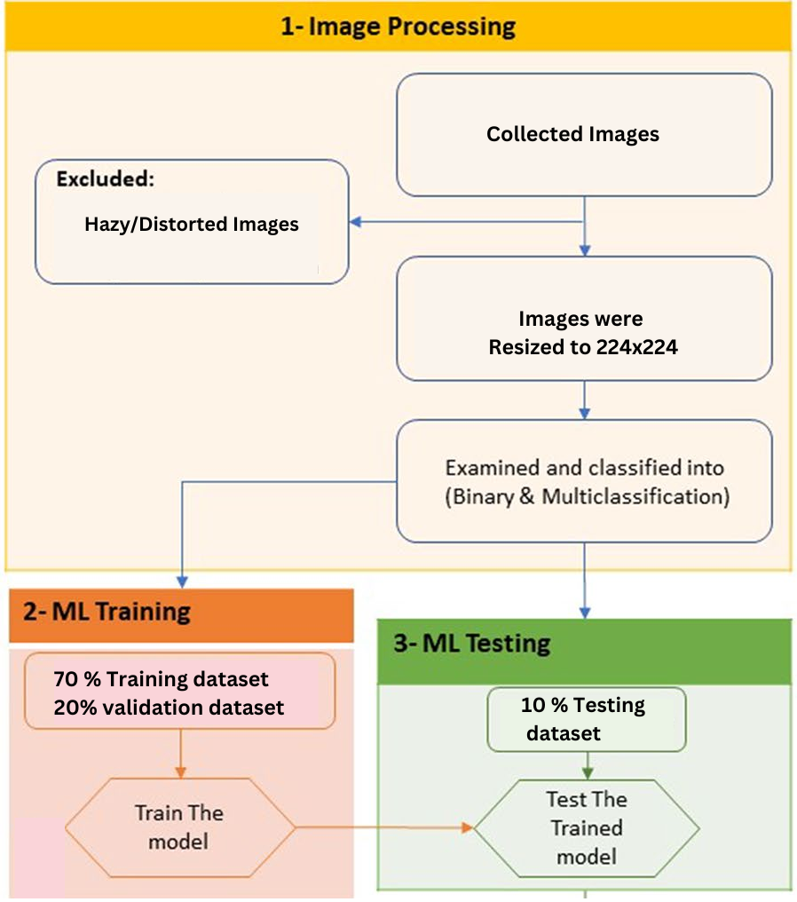
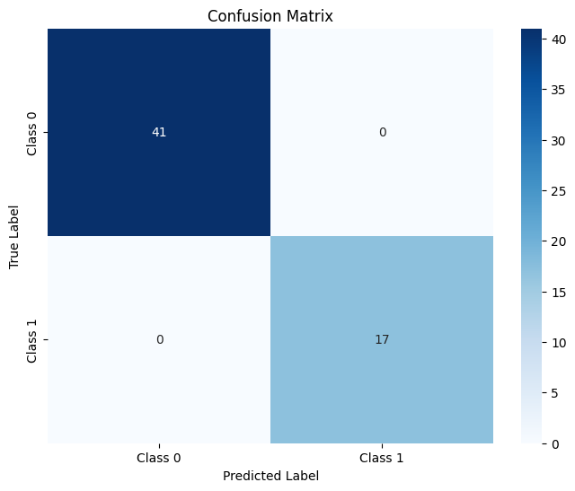
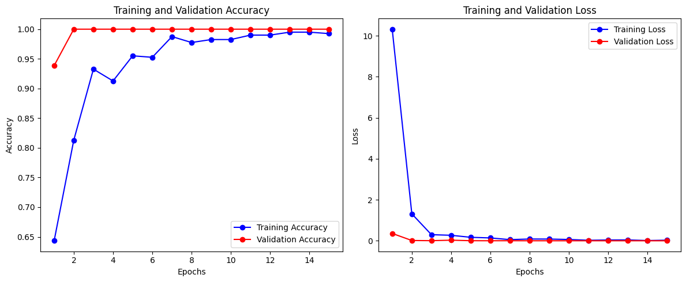
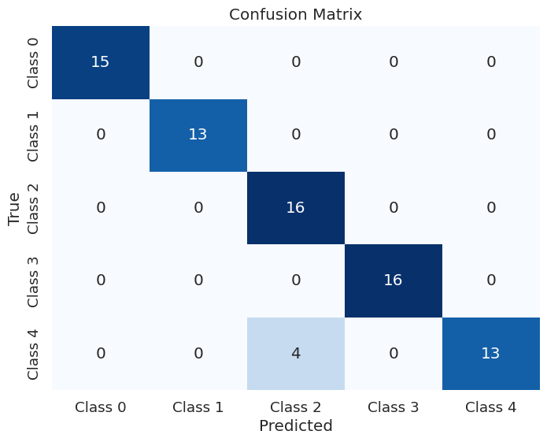
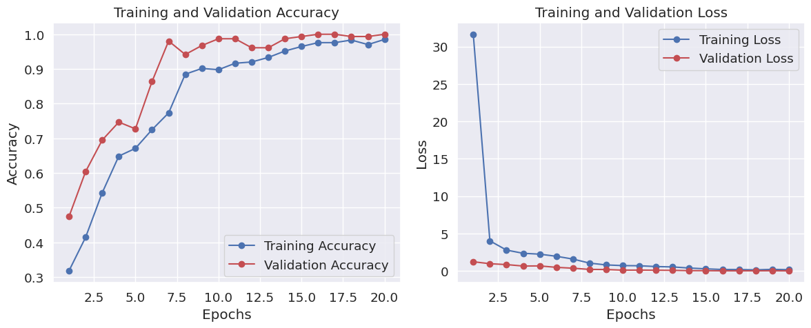

# Categorising Conjunctivitis from Eye Photographs: Final-Year Project

> **This repository has moved.** The paper, code and figures are now together in **[EshaRana17/Conjunctivitis](https://github.com/EshaRana17/Conjunctivitis)**, which carries this repository's history. This copy is kept for reference only.

**Author:** Esha Sabir · **Supervisor:** Umber Noureen · University of Sahiwal

Undergraduate final-year project (thesis). Research code, not a medical device.

## Abstract

This final-year project studies whether a convolutional neural network pretrained on ImageNet can detect conjunctivitis in ordinary eye photographs and separate its main subtypes. Two models are built on a truncated VGG-16. The first is binary (conjunctivitis vs healthy eye). The second has five classes: allergic, bacterial and viral conjunctivitis, uveitis and healthy eye. This repository holds the project's methodology diagram and the result figures from the thesis runs. The binary model classified all 58 held-out test images correctly. The five-class model in the thesis run classified 73 of 77 test images correctly (accuracy 0.948). The training code and a later re-run of the five-class model are in the companion repository [EshaRana17/Conjunctivitis](https://github.com/EshaRana17/Conjunctivitis). The test sets are small and the evaluation uses a single random split, so these are preliminary results.

## Problem and clinical motivation

Conjunctivitis is a common and contagious inflammation of the conjunctiva. Its bacterial, viral and allergic forms are managed differently but often look similar, and diagnosis in primary care usually rests on visual examination alone. In 2023 a viral conjunctivitis outbreak in Pakistan led to school closures across Punjab. An image-based screening aid could support triage where specialists are scarce, but it needs careful validation before any clinical use. This project explores the first, technical step: can a pretrained CNN separate these conditions on publicly collected images?

## Dataset

The images are not stored in this repository. They were collected from public online eye-image datasets and sorted into class folders. Hazy or distorted images were excluded, and every image was resized to 224×224 (see the methodology figure). The draft manuscript cites two sources: S. Ali, *Conjunctivitis dataset*, and Kondwani, *Eye disease dataset*. The images are not redistributed here and remain under their sources' terms.

Exact image counts for the thesis runs were not recorded in this repository. The re-run in the companion repository uses 573 images for the binary task and 769 images for the five-class task (allergic 130, bacterial 150, viral 130, uveitis 150, healthy 209), split about 70/20/10 into training, validation and test sets.

## Method



*Figure 1. Project pipeline.*

- **Backbone:** VGG-16 with ImageNet weights, truncated after `block4_conv3`. All layers are fine-tuned.
- **Binary head:** global average pooling → Dense 512 (ReLU) → Dropout 0.7 → Dense 256 (ReLU) → Dropout 0.5 → softmax (2 classes).
- **Five-class head:** global average pooling → Dense 256 (ReLU) → Dropout 0.5 → softmax (5 classes).
- **Training:** Adam (learning rate 1e-4) and categorical cross-entropy. The learning rate is held constant for 10 epochs and then decays exponentially. Early stopping on validation loss (patience 3), inverse-frequency class weights, up to 20 epochs.

The full code, exact layer listing and parameter counts are in the [companion repository](https://github.com/EshaRana17/Conjunctivitis).

## Results

### Binary: conjunctivitis vs healthy eye



*Figure 2. Binary test confusion matrix (58 images; class 0 = conjunctivitis, class 1 = healthy eye).* All 58 test images are classified correctly, so accuracy, precision, recall and F1 are all 1.0. This is the same run whose outputs are saved in `binary.ipynb` in the companion repository; that notebook also reports MCC = 1.0 and Cohen's κ = 1.0.



*Figure 3. Binary training curves. Early stopping ended training after 15 epochs.*

### Five-class: allergic, bacterial, viral, uveitis, healthy



*Figure 4. Five-class test confusion matrix from the thesis run (77 images).* The class-index-to-name mapping was not saved with this figure.

Computed from Figure 4 (weighted averages):

| Accuracy | Precision | Recall | F1 |
|---|---|---|---|
| 0.948 (73/77) | 0.958 | 0.948 | 0.947 |

All four errors are images of class 4 predicted as class 2.



*Figure 5. Five-class training curves for the thesis run (20 epochs).*

A later re-run of the five-class model, saved in `Multi_classification.ipynb` in the companion repository, reached 76/77 correct on its test split (accuracy 0.987, weighted F1 0.987, MCC 0.984). The two runs differ, and neither is a robust estimate of real-world performance (see Limitations).

## How to reproduce

This repository contains only figures. To reproduce the experiments, use the notebooks and step-by-step instructions in [EshaRana17/Conjunctivitis](https://github.com/EshaRana17/Conjunctivitis#how-to-reproduce):

```bash
git clone https://github.com/EshaRana17/Conjunctivitis.git
cd Conjunctivitis
pip install -r requirements.txt
```

Then follow that README to place the datasets in Google Drive and run `binary.ipynb` and `Multi_classification.ipynb`.

## Repository structure

```
.
├── figures/
│   ├── methodology.png                 # Figure 1
│   ├── binary_confusion_matrix.png     # Figure 2
│   ├── binary_training_curves.png      # Figure 3
│   ├── multiclass_confusion_matrix.png # Figure 4
│   └── multiclass_training_curves.png  # Figure 5
├── esha_conjunctivitis_ieee.pdf        # draft manuscript (not peer reviewed)
├── CITATION.cff
├── LICENSE                             # MIT
└── README.md
```

## Limitations

- **Small test sets and one split.** 58 and 77 test images, one random split that is not stratified, no cross-validation and no confidence intervals. One image changes accuracy by about 1.3–1.7 points.
- **Run-to-run variation.** Two five-class runs gave 0.948 and 0.987 test accuracy, so a single number should not be quoted as "the" accuracy.
- **Possible leakage and shortcut learning.** The images come from several public collections. The split is not grouped by patient or source, and near-duplicates were not removed, so the model may partly learn which collection an image came from rather than the disease.
- **No clinical validation.** Labels come from the public datasets and were not confirmed by an ophthalmologist for this study. There is no external test set.
- **No severity grading or treatment advice is implemented** in the code. These were discussed as future work.

## Ethical note

This is a student research project. It is **not** a medical device and must not be used to diagnose, triage or treat anyone. Eye photographs are health data; future data collection needs informed consent and ethics approval.

## Citation

```bibtex
@misc{sabir_conjunctivitis_fyp,
  author       = {Sabir, Esha},
  title        = {Categorising Conjunctivitis from Eye Photographs: Final-Year Project},
  howpublished = {\url{https://github.com/EshaRana17/Categorising-conjunctivitis-FYP-Thesis}},
  year         = {2024}
}
```

## Licence

MIT, see [LICENSE](LICENSE). The source datasets are not included and remain under their own licences.

## Contact

Esha Sabir · GitHub [@EshaRana17](https://github.com/EshaRana17) · [LinkedIn](https://www.linkedin.com/in/esha-sabir-3b269a220/)
